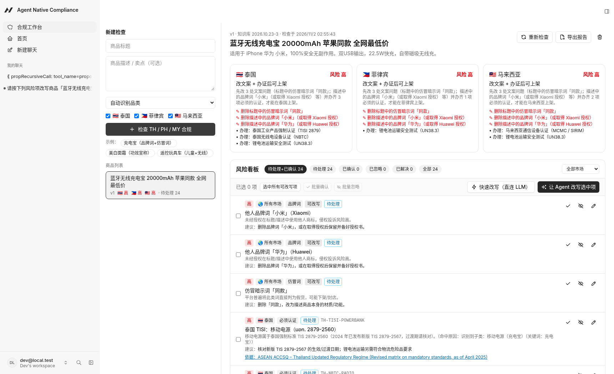

# 出海合规工作台 · SEA Listing Compliance Workbench

An **agent-native** workbench for Chinese cross-border sellers who list products in **Thailand, the Philippines and Malaysia**. Paste a product listing. The app checks it against a cited rule base covering mandatory certification, labelling, platform bans, brand and counterfeit wording, and logistics. A human reviews the findings on a **risk board**. Then you **select risk items and have the agent rewrite the listing**, and the result comes back as a reviewable **diff** you can apply or discard.

Built for the Builder.io Agent-Native Hackathon (development period starting 2026-10-27) on `@agent-native/core` 0.222.2 (chat template).



## What makes it agent-native

Every capability is a `defineAction` in `actions/`. The **same actions** serve the UI (`useActionQuery` / `useActionMutation`), the agent (as tools), HTTP (`/_agent-native/actions/<name>`) and the CLI.

| Action | Used by UI | Used by agent | What it does |
|---|---|---|---|
| `create-listing` | ✅ new-listing form | ✅ | Save a listing and run the check |
| `update-listing` / `delete-listing` | ✅ (delete) | ✅ | Edit text, category or markets / delete |
| `list-listings` / `get-listing` | ✅ | ✅ | Listings plus per-market verdicts, board items and pending rewrite with diff |
| `run-compliance-check` | ✅ 重新检查 | ✅ | Deterministic check. On re-check it merges by fingerprint, keeps human edits and marks vanished items as `fixed` |
| `list-issues` / `update-issue` | ✅ approve / ignore / reopen / inline edit / bulk | ✅ | Board items `open → approved / ignored / fixed`, plus note, severity and suggestion |
| `propose-rewrite` | (shows the result) | ✅ | The agent saves its rewritten title and description, with rationale and per-issue changes |
| `apply-rewrite` | ✅ 应用 / 放弃 | ✅ when the user asks | Apply (updates the listing and re-checks) or discard |
| `export-report` | ✅ 导出报告 | ✅ | Markdown audit report |
| `view-screen` | — | ✅ | Current listing plus the board **selection** (`{listingId, issueIds}`, written per browser tab) |

**Human ↔ agent loop:**
1. Check the listing.
2. Approve or ignore items and add reviewer notes on the board.
3. Tick the items to fix, then click **「让 Agent 改写选中项」**.
4. The agent sidebar opens and receives the listing id and the selected items. It calls `get-listing`, writes the new copy and calls `propose-rewrite`.
5. The workbench shows the red/green token diff.
6. **Apply** reruns the check, and resolved items move to 已解决 (resolved).

The agent is told never to invent certificate numbers. It inserts placeholders such as `[TISI 认证编号待补充]` instead.

## Pre-existing code vs. code written during the hackathon

| Path | Origin | Notes |
|---|---|---|
| `legacy/sea-precheck/src/lib/core/*.ts`, `src/lib/text.ts`, `kb/rules.json`, `kb/README.md` | **Pre-existing** (author's earlier project 「出海合规雷达」/sea-precheck, commit `a6595a1`; files last modified 2026-10-24) | Copied **unchanged**: rule KB (66 cited rules, v2026.10.23-3), category/feature detection, brand/counterfeit detection, `buildReport`, verdicts. Verify with `cd legacy/sea-precheck && sha256sum -c SHA256SUMS` |
| Agent-Native chat template (`app/` shell, `server/` plugins, config) | **Template** (`@agent-native/core` 0.222.2) | Scaffolded and then modified (sidebar link, navigation view, home path, agent prompt and tools) |
| `server/compliance/analyze.ts` | **Hackathon** | Maps the legacy per-market `Report` to board items (dedup across markets, kinds, fixable flag). Adds a generic exaggerated-claim lint (uncited, flagged for review) |
| `server/compliance/diff.ts` | **Hackathon** | CJK/Thai-aware token LCS diff |
| `server/compliance/store.ts`, `server/db/*` | **Hackathon** | Listings, issues and rewrites tables, migrations, fingerprint merge on re-check, rewrite lifecycle |
| `actions/*` (except template `hello`, `navigate`, `run`, `provider-api-request`) | **Hackathon** | All compliance actions, plus `view-screen` extended with the board selection |
| `app/components/compliance/*`, `app/routes/workspace.tsx` | **Hackathon** | Workbench UI: form, verdict cards, risk board, bulk bar, agent hand-off, diff panel, export |
| `server/plugins/agent-chat.ts` prompt + tool list, `AGENTS.md` domain section | **Hackathon** | Chinese domain prompt and rewrite workflow |

Third-party: Agent-Native framework, React Router, Drizzle, PGlite, Tailwind, Tabler icons and zod. The LLM is Zhipu GLM (`glm-5.3-flash`) via its OpenAI-compatible API, and any OpenAI-compatible model works.

## Run locally

Requirements: Node ≥ 22.22 and pnpm (via corepack).

```bash
export COREPACK_HOME=$HOME/.cache/corepack   # only needed if corepack's default dir is read-only
pnpm install
cp .env.example .env        # then put your key in OPENAI_API_KEY (.env is gitignored)
pnpm dev                    # → http://localhost:8080/workspace
```

`.env` keys:
- `AUTH_DISABLED=true` for a local demo without login.
- `AGENT_ENGINE=ai-sdk:openai`, `AGENT_MODEL` and `OPENAI_BASE_URL` for the Zhipu OpenAI-compatible endpoint.
- `OPENAI_API_KEY`.

The data is stored locally in PGlite under `data/`. Without a key the check, board, diff and apply all still work, and only the agent rewrite needs the LLM.

Checks: `pnpm typecheck`, `pnpm agent-native:doctor`.

## Screenshots (Playwright, headless Chrome)

| | |
|---|---|
| `01-workbench-empty.png` | Empty workbench |
| `02-new-listing-form.png` | Demo listing filled in (power bank with brand words, "同款" and "全网最低价") |
| `03-risk-board-after-check.png` | Per-market verdicts + risk board |
| `04-edit-issue-inline.png` | Inline edit of an item (reviewer note handed to the agent) |
| `05-select-fixable-items.png` | Selecting rewriteable items |
| `06-agent-rewriting-in-sidebar.png` | Agent sidebar working on the selected items |
| `07-rewrite-diff.png`, `07b-rewrite-diff-detail.png` | Agent's proposal as a diff with rationale and per-issue changes |
| `08-after-apply-fixed-items.png` | After apply + automatic re-check: items moved to 已解决 |
| `09-exported-report.md` / `.png` | Exported Markdown report |

## Limitations

- The rule KB is a snapshot (v2026.10.23-3). Some sources are third-party or need JS, and the board labels those. Certification items cannot be fixed by rewriting copy. The agent explains that and leaves placeholders.
- The exaggerated-claim lint (`CLAIM_TERMS`) is a generic heuristic and has no regulation citation.
- The per-market label comes from the legacy verdict logic, so it can read 「办证后可上架」 (can list after certification) while a brand word still has to be removed. The headline beneath it always states that.

**Disclaimer:** this is an automated pre-check based on excerpts of public regulations. It is not legal advice. Confirm with the authorities or a certification agent before listing.
